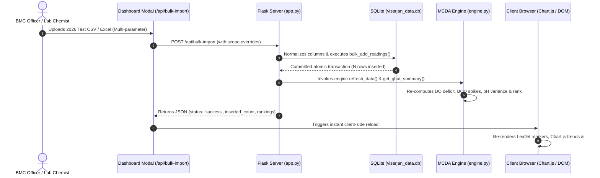

# 🏛️ Technical Architecture: Visarjan Ghat Watch

## 1. System Architecture Diagram

```mermaid
flowchart TD
    subgraph Data Sources
        P1["MPPCB 2023 Report PDF"] --> ETL["Data Cleaning & Normalization"]
        P2["MPPCB 2024 Report PDF"] --> ETL
        P3["MPPCB 2025 Report PDF"] --> ETL
        CSV["bhopal_ghats_2023_2025.csv (1,524 Rows)"] --> DB[("SQLite Database\n(visarjan_data.db)")]
        ETL --> DB
    end

    subgraph Backend Core (Python / Flask)
        DB <--> DBLayer["database.py (Database Layer)"]
        DBLayer <--> Engine["analysis/engine.py (MCDA Engine)"]
        Engine <--> App["app.py (Flask Web Application)"]
        Engine <--> Chatbot["chatbot_assistant.py (Grounded Assistant)"]
    end

    subgraph Dynamic Ingestion
        Upload["CSV / Excel Upload (/api/bulk-import)"] --> DBLayer
        NewGhat["Ghat Registration (/api/add-ghat)"] --> DBLayer
        DBLayer --> ReCalc["Auto Recalculation Engine"] --> Engine
    end

    subgraph Presentation & Visualization Layer
        App --> Dash["/ (Executive Dashboard)"]
        App --> Deep["/ghat/<site> (Deep-Dive Trends)"]
        App --> Brief["/brief (Bilingual Officer Memo)"]
        App --> Trace["/traceability (Traceability Table)"]
        App --> PDFServ["/pdf/<file>#page=X (Direct PDF Jump)"]
        
        Dash --> Sliders["Dynamic Sensitivity Sliders (MCDA)"]
        Dash --> GIS["Leaflet.js GIS Geospatial Map"]
        Dash --> C1["Chart.js YoY Risk Comparison"]
        Dash --> C2["Chart.js Shock Delta Impact"]
        Dash --> BotUI["Bilingual AI Chatbot Assistant"]
    end
```

---

## 2. Component Inventory & Filename Mapping

| File / Component | Language / Framework | Core Responsibility |
| :--- | :--- | :--- |
| **`app.py`** | Python 3.10+, Flask | Web server, route dispatching, REST API endpoints, PDF serving. |
| **`database.py`** | Python, SQLite3 | Persistent database connection, initial seeding, dynamic inserts, batch ingestion. |
| **`analysis/engine.py`** | Python, Pandas, NumPy | Mathematical MCDA risk engine, CPCB Class B compliance tagging, YoY metrics. |
| **`chatbot_assistant.py`** | Python | Natural language query matcher, Hinglish alias resolution, citations parser. |
| **`templates/base.html`** | Jinja2, HTML5, Tailwind | Root template, global bilingual toggle (`hi`/`en`), persistent chatbot drawer. |
| **`templates/dashboard.html`**| Jinja2, Chart.js, Leaflet | Executive dashboard, KPI cards, Leaflet GIS map, bulk import & registration modals. |
| **`templates/ghat_detail.html`**| Jinja2, Chart.js | Ghat deep-dive, cinematic MPPCB hero banner, interactive 5-axis filter controls. |
| **`templates/brief.html`** | Jinja2, Tailwind | Printable bilingual executive briefing memo for administrative forwarding. |
| **`templates/traceability.html`**| Jinja2, HTML5 | Full 1,524 test table with direct links to official PDF report pages. |
| **`test_system.py`** | Python | Automated 7-step test suite verifying database integrity, routes, and uploads. |
| **`run.bat`** | Windows Batch Script | One-click automated virtualenv setup, dependency installation, and launcher. |

---

## 3. End-to-End Data Journey (Lifecycle of a Water Sample)



---

## 4. API Endpoints Specification

1. **`GET /`**: Renders executive dashboard with initial 50/40/10 sensitivity weights.
2. **`GET /ghat/<site_name>`**: Renders individual deep-dive page for a specific ghat.
3. **`GET /brief`**: Renders printable bilingual executive memo.
4. **`GET /traceability`**: Renders search-ready table of all verified test readings.
5. **`GET /api/summary?w_do=X&w_bod=Y&w_ph=Z`**: Returns real-time MCDA risk score rankings as JSON.
6. **`GET /api/readings?ghat=<site>`**: Returns raw readings list for a specific ghat.
7. **`POST /api/add-reading`**: Adds a single water test reading into SQLite database.
8. **`POST /api/add-ghat`**: Dynamically registers a newly constructed ghat or artificial kund.
9. **`POST /api/bulk-import`**: Batch ingests CSV/Excel files and triggers instant recalculation.
10. **`POST /api/chat`**: Grounded Q&A assistant endpoint returning verified citations.
11. **`GET /download-template`**: Downloads standardized multi-parameter CSV upload template.
12. **`GET /export-csv`**: Downloads complete risk ranking report in CSV format.
13. **`GET /pdf/<filename>`**: Directly serves official MPPCB source PDF reports.
